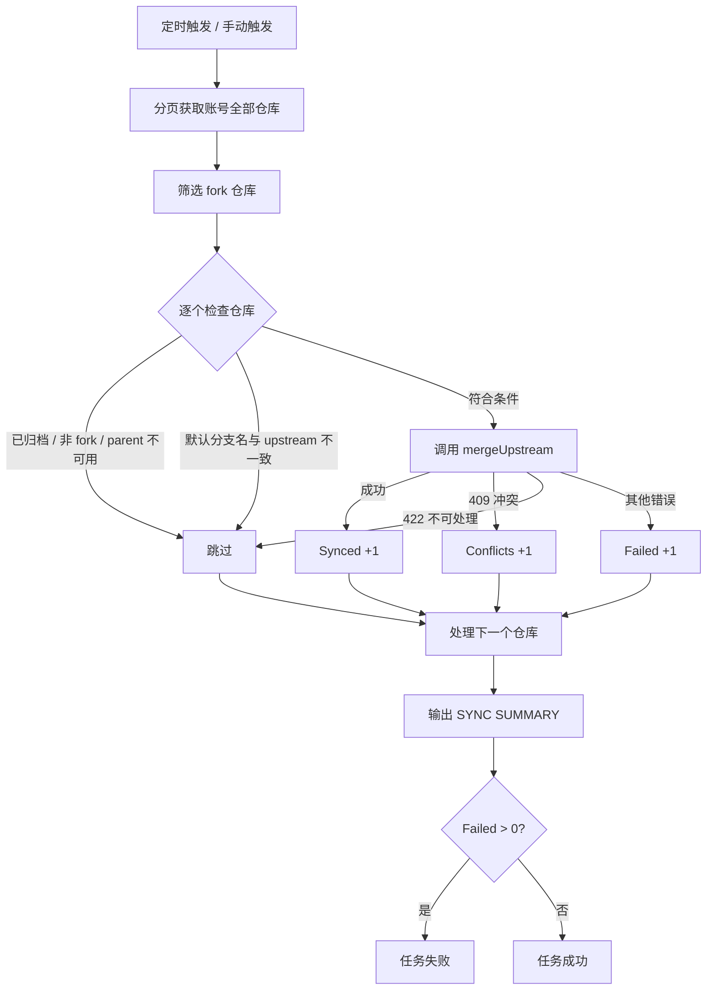

# fork-syncer

自动同步当前 GitHub 账号下所有 fork 仓库：定时发现账号中的全部 fork，并将其默认分支与各自 upstream 的默认分支保持同步。

整个项目只有一个 GitHub Actions workflow，无需部署或本地运行。

## 功能

- **自动发现**：通过 GitHub API 分页获取账号下的全部仓库，自动筛选其中的 fork。
- **定时同步**：每 6 小时运行一次（UTC 时间）。
- **手动触发**：支持 `workflow_dispatch`，可在 Actions 页面或使用 `gh` 手动运行。
- **逐仓库容错**：单个仓库失败不会中断其他仓库的同步。
- **抑制 Fork CI**：同步期间临时禁用 fork 的 Actions，避免推送触发 fork 中继承自 upstream 的 workflow；同步结束后自动恢复。
- **结果汇总**：运行结束时输出 `SYNC SUMMARY`，仅当存在真正的执行失败时标记任务失败。

## 工作原理



同步前会对每个仓库执行以下检查，任一不满足即跳过：

1. 仓库未被归档。
2. 仓库详情可正常获取，且确实为 fork。
3. fork 的 parent（upstream）存在。
4. fork 与 upstream 的默认分支名称一致。

## 快速开始

1. 创建一个可读写目标仓库的 Personal Access Token：
   - Classic token：勾选 `repo` 与 `workflow` 权限；`workflow` 用于推送包含 `.github/workflows/**` 修改的提交。
   - Fine-grained token：对所有需要同步的 fork 授予 `Contents: Read and write`、`Workflows: Read and write` 与 `Administration: Read and write`；`Administration` 用于同步期间临时禁用并恢复 fork 的 Actions。
2. 在本仓库的 **Settings → Secrets and variables → Actions** 中添加 secret：`FORK_SYNC_TOKEN`。
3. 确认 workflow 已在 Actions 页面启用。
4. 等待定时任务，或手动触发一次：

   ```bash
   gh workflow run fork-sync.yml
   ```

## 同步规则

| 情况 | 处理结果 |
| --- | --- |
| 仓库已归档 | 跳过（Skipped） |
| 仓库详情获取失败 | 跳过（Skipped） |
| 不是 fork / parent 不可用 | 跳过（Skipped） |
| 默认分支缺失或与 upstream 不一致 | 跳过（Skipped） |
| 同步成功 | Synced |
| 409：存在无法自动解决的冲突 | Conflicts，需手动处理 |
| 422：请求无法处理 | 跳过（Skipped） |
| 其他错误 | Failed |

> 分支名不一致时采取保守策略跳过，避免把 upstream 的内容同步到错误的分支。

## 运行结果

每次运行结束后，日志末尾会输出统计信息：

```text
====================================
          SYNC SUMMARY
====================================
Account: <your-account>
Total repositories: 42
Total forks: 10
Synced: 7
Skipped: 2
Conflicts: 1
Failed: 0
====================================
```

只有 `Failed > 0` 时任务才会失败；冲突和跳过不会导致任务失败。

## 配置说明

- **执行频率**：在 `.github/workflows/fork-sync.yml` 的 `schedule.cron` 中调整，默认每 6 小时一次。
- **并发控制**：`concurrency` 组 `github-fork-sync` 保证同一时间只有一个同步任务运行。
- **权限**：workflow 显式设置了 `permissions: {}`，不使用默认的 `GITHUB_TOKEN`；所有跨仓库操作都通过 `FORK_SYNC_TOKEN` 完成。
- **超时**：单个 job 最多运行 60 分钟。

## 限制

- 仅同步每个 fork 的**默认分支**，其他分支不会被处理。
- 不会自动解决冲突；遇到 409 的仓库需要手动在 GitHub 上处理。
- fork 与 upstream 的默认分支名必须一致，否则会被跳过。
- 公开仓库长时间无提交时，GitHub 可能自动停用定时 workflow，需要到 Actions 页面重新启用。

## 项目结构

```text
.github/workflows/fork-sync.yml   # 全部同步逻辑（actions/github-script）
README.md                         # 项目说明
```
